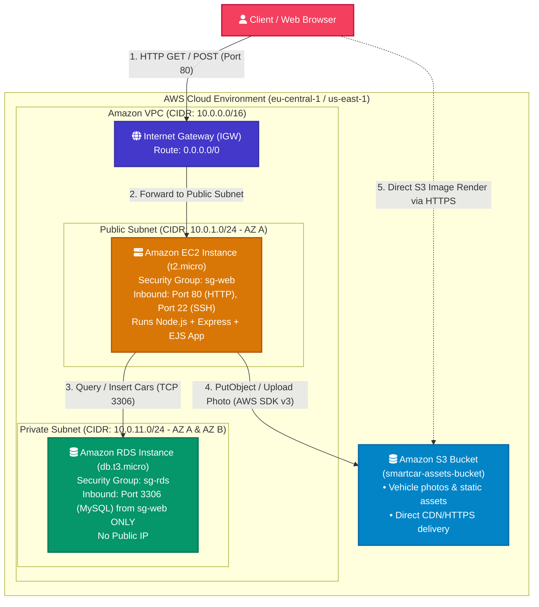

# AWS Cloud Architecture Documentation
**Course:** Software Engineering for Cloud Applications  
**Institution:** Arab Academy for Science, Technology and Maritime Transport (AASTMT)  
**Project:** Smart Car Rental Multi-Tier Cloud Application  
**Team:** 3 Students  

---

## 1. Executive Summary & Architecture Overview

The Smart Car Rental application is implemented as an enterprise-grade, highly available, secure multi-tier architecture on Amazon Web Services (AWS). The infrastructure follows the **AWS Well-Architected Framework**, separating presentation, compute, persistent relational storage, and static object assets into distinct security and network zones.

---

## 2. Architecture Diagram

---

## 3. Network Topology & Subnet Breakdown

| Component | CIDR / Identifier | Availability Zone | Routing / Access | Role in Project |
| :--- | :--- | :--- | :--- | :--- |
| **Amazon VPC** | `10.0.0.0/16` | Multi-AZ | Dedicated virtual network | Complete boundary isolation |
| **Internet Gateway** | `igw-smartcar` | Region-wide | Attached to Custom VPC | Grants internet access to public subnets |
| **Public Subnet A** | `10.0.1.0/24` | `az-a` | Route `0.0.0.0/0` -> `igw` | Hosts the web server EC2 instance |
| **Public Subnet B** | `10.0.2.0/24` | `az-b` | Route `0.0.0.0/0` -> `igw` | Multi-AZ redundancy & RDS Subnet Group |
| **Private Subnet A** | `10.0.11.0/24` | `az-a` | Local route only (`10.0.0.0/16`) | Hosts primary Amazon RDS DB |
| **Private Subnet B** | `10.0.12.0/24` | `az-b` | Local route only (`10.0.0.0/16`) | RDS DB Subnet Group failover subnet |

---

## 4. Security Group Configurations (Least Privilege)

### A. Web Server Security Group (`sg-web`)
Attached to: **Amazon EC2 Instance**
* **Inbound Rules:**
  * `HTTP` (TCP Port 80) from `0.0.0.0/0` (Allows end-users to visit website).
  * `SSH` (TCP Port 22) from Administrator IP (Allows secure server management).
* **Outbound Rules:**
  * All traffic allowed (`0.0.0.0/0`) for downloading packages and communicating with AWS services.

### B. Database Security Group (`sg-rds`)
Attached to: **Amazon RDS MySQL/PostgreSQL Instance**
* **Inbound Rules:**
  * `MySQL/Aurora` (TCP Port 3306) **ONLY** from source security group `sg-web`.
  * *Critical Security Feature:* No IP address range (`0.0.0.0/0`) can touch the database. The database is invisible to the public internet.
* **Outbound Rules:**
  * Restricted to internal VPC response traffic.

---

## 5. Storage Architecture & Media Flow

1. **Amazon EC2 Root Volume (EBS):**
   * Stores the operating system (Amazon Linux 2023), Node.js runtime, and application source code.
2. **Amazon S3 (`smartcar-assets-...`):**
   * Stores user-uploaded vehicle photos.
   * Eliminates state on the EC2 instance, allowing future autoscaling without file synchronization issues.
   * Web frontend renders images directly via public HTTPS S3 Object URLs.
3. **Amazon RDS (`car_rental_db`):**
   * Persists vehicle metadata: `make`, `model`, `year`, `category`, `daily_rate`, `description`, and `image_url` (pointing to S3).

---

## 6. Official AWS Architecture Diagram Submission Checklist

When presenting this diagram to the examination committee:
- [x] **AWS Cloud Boundary** clearly delineated with region notation.
- [x] **Custom Amazon VPC** with CIDR block specified (`10.0.0.0/16`).
- [x] **Subnets** differentiated between Public Subnet (with IGW route) and Private Subnet (isolated).
- [x] **Amazon EC2** placed inside Public Subnet with port 80 listener.
- [x] **Amazon RDS** placed inside Private Subnet with DB Subnet Group across 2 AZs.
- [x] **Amazon S3** placed in AWS Cloud, connected via IAM Role / SDK.
- [x] **Security Groups** explicitly labeled showing port and source filtering.
- [x] **User Flow Arrow** traversing from Internet -> IGW -> EC2 -> RDS / S3.

