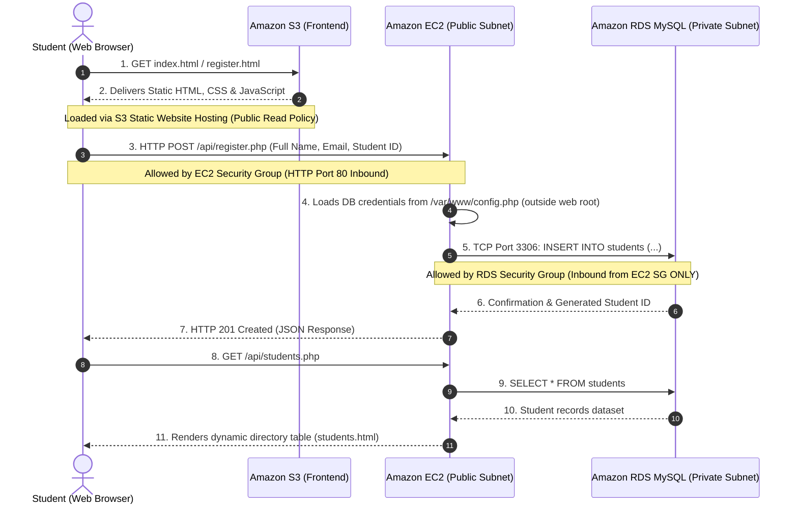

# Student Registration Website — AWS Cloud Architecture
**Course:** Software Engineering for Cloud Applications  
**Institution:** Arab Academy for Science, Technology and Maritime Transport (AASTMT)  
**Team Formation:** Exactly 3 Students  
**Architecture Reference:** Standard Lab Section Blueprint (Europe Stockholm / Frankfurt)  

---

## 1. Project Overview & Fulfillment Matrix

This project implements and deploys a multi-tier cloud application on Amazon Web Services (AWS) that strictly matches the requirements from the course specification and lab section blueprint:

| Project Requirement | Implementation in this Repository | AWS Service Used |
| :--- | :--- | :--- |
| **Minimum 3 Functional Pages** | 1. **Home Page (`index.html`)**: Portal overview & AWS status. 2. **Listing Page (`students.html`)**: Queries `STUDENT_REGISTRATION.students` dynamically. 3. **Form / Upload (`register.html`)**: Submits Full Name, Email, Student ID, and Photo. | **Amazon S3 Static Website Hosting** |
| **Custom Network (VPC)** | `website-vpc` (`10.0.0.0/16`) with Public Subnet (`10.0.1.0/24`) and Private Database Subnet (`10.0.11.0/24`). | **Amazon VPC** |
| **Compute & API Backend** | Apache HTTP Server + PHP hosting `/var/www/html/api/register.php` & `/api/students.php` on Port 80. | **Amazon EC2 (t2.micro)** |
| **Relational Database** | Managed MySQL 8.0 instance running database `STUDENT_REGISTRATION` and table `students`. | **Amazon RDS for MySQL** |
| **Credentials Security** | Database credentials strictly stored outside the web root at `/var/www/config.php`. | **EC2 File System Security** |
| **Network Security** | EC2 SG allows HTTP Port 80; RDS SG allows MySQL Port 3306 **ONLY** from EC2 SG. | **AWS Security Groups** |
| **Architecture Diagram** | High-resolution diagram matching the exact lab slide specifications. | **AWS Architecture Blueprint** |

---

## 2. Team Member Division & Responsibilities (Team of 3)

| Student Name | Student ID | Specialty Role for Oral Exam Discussion |
| :--- | :--- | :--- |
| **Student 1** | *[Insert ID]* | **Amazon VPC & Network Topology:** Custom VPC (`website-vpc`), Public vs. Private Subnets, Internet Gateway, and Route Tables. |
| **Student 2** | *[Insert ID]* | **Amazon EC2 & Backend Architecture:** Apache/PHP installation, `/api/register.php`, database credentials storage outside web root, and EC2 Security Group. |
| **Student 3** | *[Insert ID]* | **Amazon RDS & Amazon S3 Storage:** MySQL `STUDENT_REGISTRATION.students` schema, DB Subnet Groups, S3 Static Website Hosting, and Bucket Policies. |

---

## 3. End-to-End Application Flow

---

## 4. Step-by-Step 1-Click Deployment

### Method 1: AWS CloudFormation (Fastest & Guaranteed)
1. Sign in to your AWS Console at [`https://419603636642.signin.aws.amazon.com/console`](https://419603636642.signin.aws.amazon.com/console).
2. In the top search bar, search for **CloudFormation** and open it.
3. Click the orange **Create stack** button &rarr; choose **With new resources (standard)**.
4. Select **Upload a template file** &rarr; choose `student-registration-cloudformation.yaml`.
5. Name the stack `StudentRegistrationApp` &rarr; click **Next** &rarr; click **Next** &rarr; click **Submit**!
6. In ~5 to 7 minutes, the stack status will change to **`CREATE_COMPLETE`**.
7. Open the **Outputs** tab to view your live links:
   - **`S3FrontendWebsiteURL`**: Click to open your live frontend on Amazon S3!
   - **`EC2BackendPublicURL`**: The live Apache/PHP API server on Amazon EC2.
   - **`RDSEndpoint`**: The internal MySQL database hostname.

---

## 5. Architecture Diagram Deliverable

The architecture diagram deliverable matching your lab section slide is available in two formats:
- **Interactive Viewer & PNG Downloader:** Open [`aws-architecture-diagram.html`](file:///c:/Users/User/.gemini/antigravity-ide/scratch/smart-car-rental/aws-smart-car-rental/aws-architecture-diagram.html) in your browser and click **Download High-Res PNG**.
- **Vector Source File:** [`aws-architecture-diagram.svg`](file:///c:/Users/User/.gemini/antigravity-ide/scratch/smart-car-rental/aws-smart-car-rental/aws-architecture-diagram.svg).

---

## 6. Oral Exam Defense Questions (Section 6 Requirement)

### Question 1: Why are the database credentials stored in `/var/www/config.php` outside the web root?
* **Model Answer:** If database credentials were placed inside the web root (`/var/www/html/`), any web server misconfiguration (such as PHP crashing or serving `.php` files as plain text) could expose our database master password to the public internet. Placing credentials outside the web root (`/var/www/config.php`) ensures they cannot be accessed or downloaded via HTTP requests.

### Question 2: Why is Amazon RDS placed in a private subnet while EC2 is in a public subnet?
* **Model Answer:** This implements the **defense-in-depth** security pattern. The public subnet has an Internet Gateway route so students can access the website on port 80. The private database subnet has **NO Internet Gateway route**, meaning the database has no public IP address and is completely unreachable from the public internet. Only instances inside the VPC (our EC2 server) can query it.

### Question 3: How is the RDS Security Group restricted?
* **Model Answer:** The RDS Security Group does not accept connections from IP address ranges (`0.0.0.0/0`). Instead, its inbound rule allows MySQL traffic on port 3306 **strictly from the EC2 Security Group ID (`sg-web`)**. Even if another unauthorized instance is launched inside the VPC, it cannot communicate with the database.

### Question 4: How does S3 Static Website Hosting interact with EC2?
* **Model Answer:** Amazon S3 delivers static files (`index.html`, `register.html`, `students.html`) directly to the student's browser with high durability and low latency. The student's browser then makes asynchronous JavaScript API requests (AJAX/Fetch) directly to the EC2 backend API (`POST /api/register.php`), decoupling presentation from compute.

