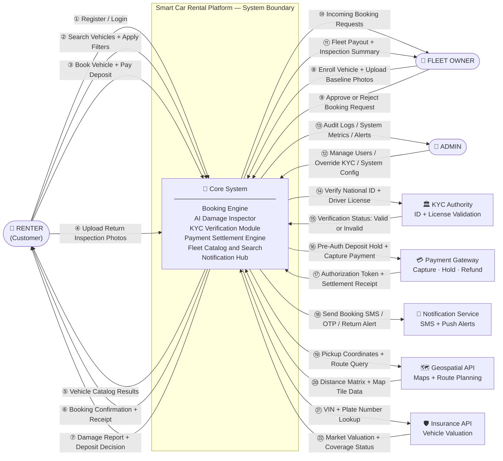
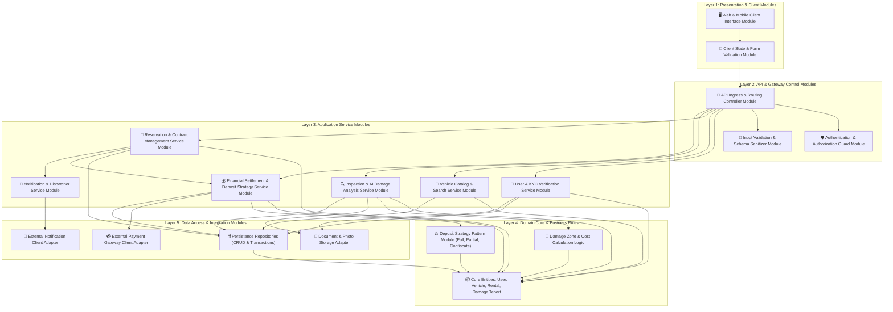
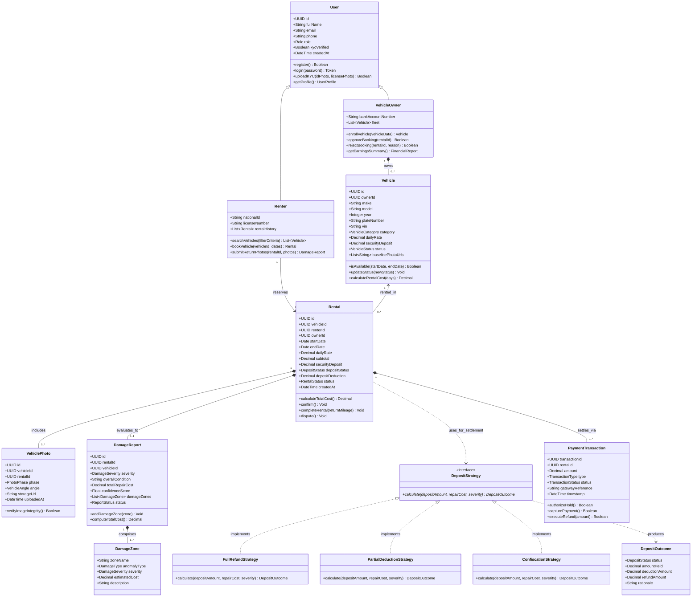
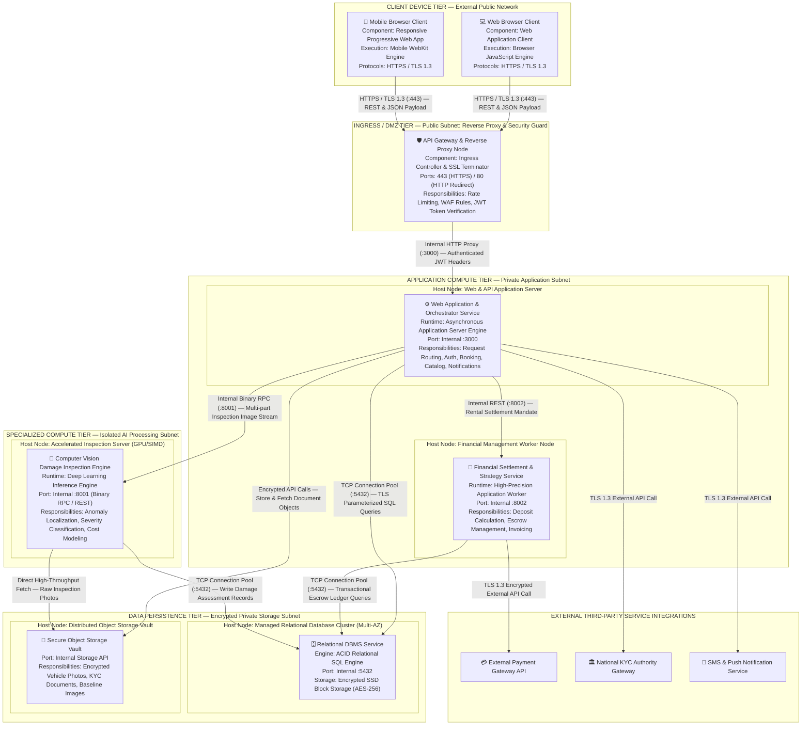
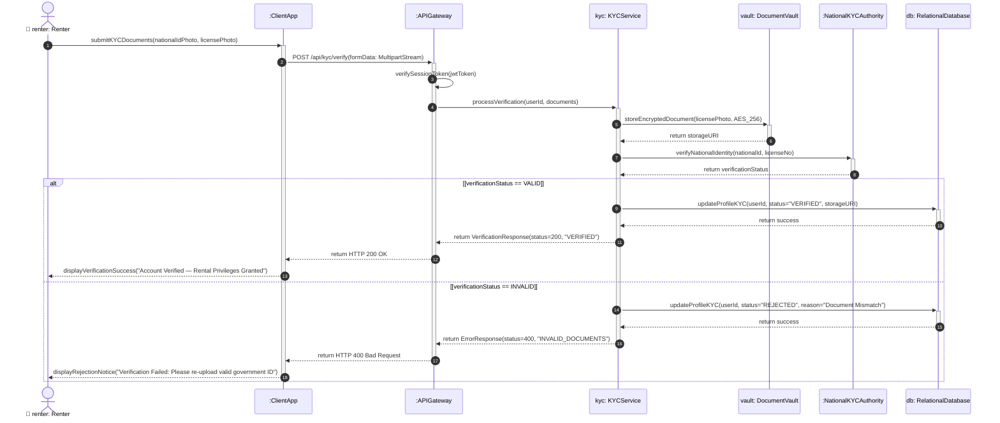
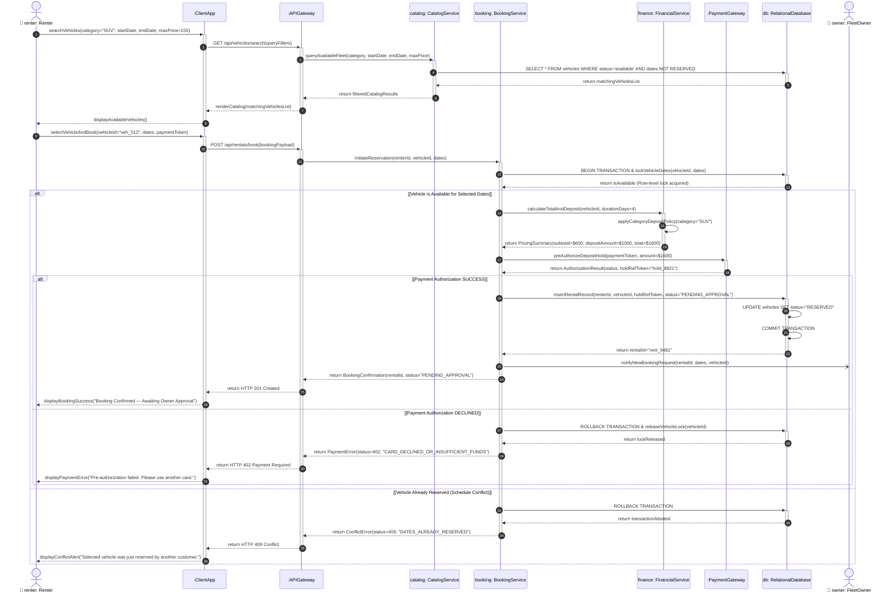
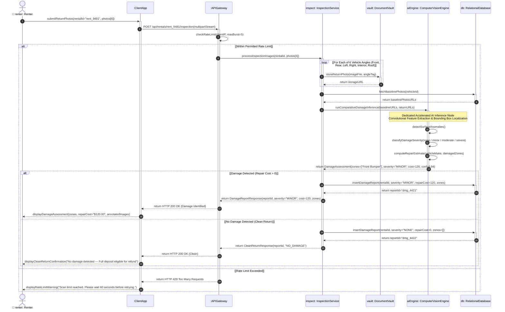
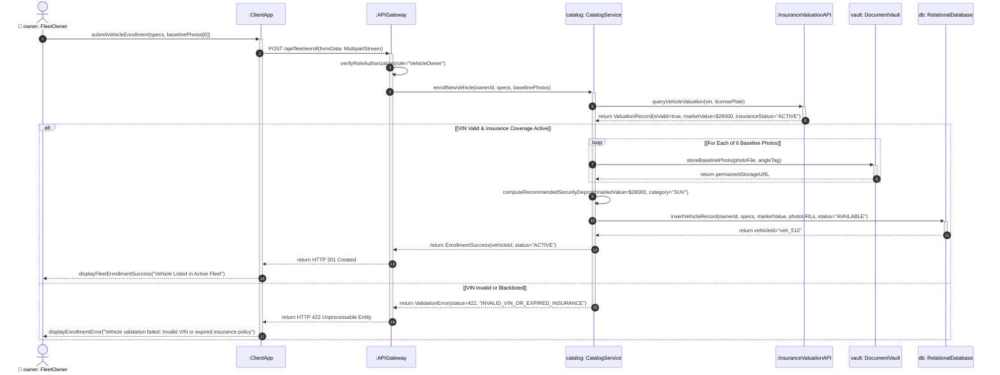
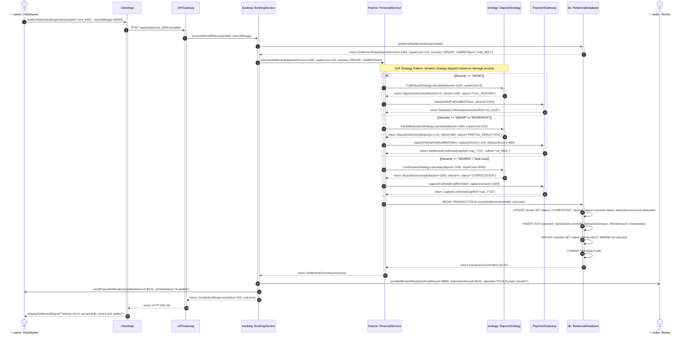

# Smart Car Rental Platform
# Complete Software Architecture Document
## Phase 1 & Phase 2 — Combined Deliverable

| Field | Details |
|---|---|
| **Academic Course** | Software Engineering for Cloud Applications / Software Architecture |
| **Institution** | Arab Academy for Science, Technology and Maritime Transport (AASTMT) |
| **System Name** | Smart Car Rental Platform |
| **Document Version** | 2.0 (Phase 1 Revised + Phase 2 Complete) |
| **Methodology** | Attribute-Driven Design (ADD v3.0) — Software Engineering Institute (SEI) |
| **Document Date** | November 2026 |

---

## Table of Contents

**PHASE 1: Requirements Engineering & Quality Analysis**
1. [Document Revision Audit (Phase 1 Corrections)](#1-document-revision-audit)
2. [Functional Requirements — Atomic Structure (FR-01 to FR-26)](#2-functional-requirements)
3. [Non-Functional Requirements & Architecturally Significant Requirements (ASRs)](#3-non-functional-requirements--architecturally-significant-requirements)
4. [Utility Tree & Prioritized Quality Attribute Scenarios](#4-utility-tree--quality-attribute-scenarios)

**PHASE 2: Architecture Design (ADD)**
5. [ADD Methodology & Process Overview](#5-add-methodology--process-overview)
6. [System Context Diagram — View 1](#6-system-context-diagram-view-1)
7. [Module Structure Diagrams — View 2 (Uses & Class)](#7-module-structure-diagrams-view-2)
   - [7.1 Uses Diagram (Module Dependency View)](#71-uses-diagram-module-dependency-view)
   - [7.2 Class Diagram (Domain Model & Strategy Pattern)](#72-class-diagram-domain-model--strategy-pattern)
8. [Unified Component & Connector + Allocation Deployment Diagram — Views 3 & 4](#8-unified-cc--allocation-deployment-diagram-views-3--4)
9. [Sequence Diagrams — Dynamic Behavioral View (5 User Flows)](#9-sequence-diagrams-dynamic-behavioral-view)
10. [Architectural Patterns, Tactics & ADD Traceability Matrix](#10-architectural-patterns-tactics--add-traceability-matrix)
11. [Oral Defense Preparation Guide](#11-oral-defense-preparation-guide)

---

---

# ═══════════════════════════════════════════════
# PHASE 1: REQUIREMENTS ENGINEERING & QUALITY ANALYSIS
# ═══════════════════════════════════════════════

---

# 1. Document Revision Audit

This document directly addresses all three formal feedback points from the Phase 1 instructor evaluation. Each error has been identified, corrected, and cross-referenced.

| # | Instructor Feedback / Error | Corrective Action Applied | Location |
|---|---|---|---|
| **1** | **Update Functional Requirement Structure** — Requirements previously bundled multiple features together | Re-engineered all requirements into strictly **atomic units**: one actor, one action, one feature boundary, one expected outcome. 26 requirements across 5 domain groups. | Section 2 |
| **2** | **Remove Early Architectural Decisions / Technologies from Phase 1** — Specific technology names (Next.js, PostgreSQL, Supabase, FastAPI, AWS, Docker) appeared in requirements | All technology-specific references removed. Requirements are stated in **purely technology-neutral, problem-space terms** (e.g., *Secure Object Vault*, *Relational Persistence Store*, *Computer Vision Engine*). | Throughout Phase 1 |
| **3** | **Update Utility Tree Scenario Structure** — Utility tree used informal one-line descriptions | Every Quality Attribute Scenario now uses the **canonical SEI 6-part structure**: Source of Stimulus, Stimulus, Artifact, Environment, Response, Response Measure — with `(Importance, Difficulty)` prioritization ratings. | Section 4 |

---

# 2. Functional Requirements

> **Rule Applied:** Every requirement specifies **exactly one feature**. No bundled workflows. Each entry has a unique ID, one Actor, one trigger, one atomic system behavior, and one expected outcome.

---

## 2.1 User Identity & Profile Management

| ID | Requirement Name | Actor | Description |
|---|---|---|---|
| **FR-01** | User Account Registration | Guest User | The system shall allow a guest user to create an account by providing an email address, password, full name, and phone number. |
| **FR-02** | User Authentication | Registered User | The system shall authenticate user credentials and issue a cryptographically signed session token upon successful validation. |
| **FR-03** | Role Assignment | Registered User | The system shall assign an access role (`Renter`, `Vehicle Owner`, or `System Administrator`) to each registered user account. |
| **FR-04** | National Identity Document Submission | Renter | The system shall accept an uploaded digital photograph of the renter's government-issued national identification card. |
| **FR-05** | Driver License Submission | Renter | The system shall accept an uploaded digital photograph of the renter's valid driving license document. |
| **FR-06** | Identity Verification Status Tracking | Renter / Administrator | The system shall maintain an explicit verification state (`Pending`, `Verified`, `Rejected`) associated with the user profile. |

---

## 2.2 Vehicle Catalog & Search

| ID | Requirement Name | Actor | Description |
|---|---|---|---|
| **FR-07** | Vehicle Listing Creation | Vehicle Owner | The system shall enable an owner to register a new vehicle by providing make, model, manufacturing year, license plate, seating capacity, and daily rental rate. |
| **FR-08** | Baseline Photo Ingestion | Vehicle Owner | The system shall store baseline exterior and interior reference images for each enrolled vehicle. |
| **FR-09** | Vehicle Inventory Category Filtering | Renter | The system shall filter available vehicles by vehicle category (`Economy`, `Sedan`, `SUV`, `Luxury`, `Electric`). |
| **FR-10** | Price Range Querying | Renter | The system shall filter the vehicle inventory by a minimum and maximum daily rate boundary specified by the renter. |
| **FR-11** | Vehicle Specification Retrieval | Renter | The system shall display detailed technical attributes, rental terms, and pickup location of a selected vehicle. |
| **FR-12** | Multi-Vehicle Side-by-Side Comparison | Renter | The system shall generate a side-by-side attribute comparison report for two or more vehicles selected by the renter. |

---

## 2.3 Booking & Contract Lifecycle

| ID | Requirement Name | Actor | Description |
|---|---|---|---|
| **FR-13** | Rental Date Availability Verification | Renter | The system shall verify whether a vehicle is unreserved for the entirety of a requested start and end date interval. |
| **FR-14** | Reservation Initiation | Renter | The system shall create a reservation record in `Pending` state linking the renter, vehicle identifier, reservation dates, and computed total rental cost. |
| **FR-15** | Security Deposit Calculation | System | The system shall compute the mandatory security deposit amount proportional to the vehicle market category and rental duration. |
| **FR-16** | Digital Contract Record Generation | System | The system shall generate an immutable rental contract record binding the renter, owner, vehicle identifier, and agreed rental terms. |
| **FR-17** | Reservation Approval or Rejection | Vehicle Owner | The system shall allow the vehicle owner to accept or decline a pending reservation request submitted by a renter. |

---

## 2.4 Vehicle Inspection & Damage Assessment

| ID | Requirement Name | Actor | Description |
|---|---|---|---|
| **FR-18** | Pre-Rental Inspection Photo Ingestion | Renter / Owner | The system shall accept and timestamp digital photographs of vehicle body zones immediately prior to trip departure. |
| **FR-19** | Post-Rental Return Photo Ingestion | Renter / Owner | The system shall accept and timestamp digital photographs of vehicle body zones immediately upon vehicle return by the renter. |
| **FR-20** | Automated Damage Zone Detection | Computer Vision Engine | The system shall process uploaded return images and detect surface damage localized to specific exterior vehicle zones (Front Bumper, Rear Bumper, Doors, Hood, Fenders, Windshield). |
| **FR-21** | Damage Severity Classification | Computer Vision Engine | The system shall classify each detected damage anomaly into a severity rating (`None`, `Minor`, `Moderate`, `Severe`). |
| **FR-22** | Repair Cost Estimation | Computer Vision Engine | The system shall estimate the monetary repair cost for each detected damage zone using calibrated market rate reference metrics. |
| **FR-23** | Security Deposit Deduction Execution | Financial Management Engine | The system shall calculate the final deposit refund or deduction amount based on the generated damage report using the deposit resolution rules. |

---

## 2.5 Payment & Financial Settlement

| ID | Requirement Name | Actor | Description |
|---|---|---|---|
| **FR-24** | Rental Fee Transaction Processing | Renter | The system shall interface with an external payment provider to capture authorized rental fee transactions from the renter. |
| **FR-25** | Security Deposit Hold Authorization | System | The system shall place a pre-authorized hold on the renter's payment method for the computed security deposit amount prior to trip start. |
| **FR-26** | Deposit Release / Refund Execution | System | The system shall release the unencumbered portion of the security deposit hold to the renter upon completion of a clean vehicle return inspection. |

---

# 3. Non-Functional Requirements & Architecturally Significant Requirements

The following **Architecturally Significant Requirements (ASRs)** represent the non-functional quality drivers that directly constrain and shape the system's structural architecture. All ASRs are stated in technology-neutral terms.

| ASR ID | Quality Attribute | Requirement |
|---|---|---|
| **ASR-01** | Availability | The rental reservation and catalog querying services must maintain **99.9% uptime** during standard operational hours. |
| **ASR-02** | Performance — Latency | Vehicle catalog search queries under normal load (up to 1,000 concurrent queries) must return responses within **1.5 seconds**. |
| **ASR-03** | Performance — Image Processing | The automated visual inspection engine must ingest, process, and return a damage assessment report within **15 seconds** of image submission. |
| **ASR-04** | Security — Data Confidentiality | All customer identification documents (national ID, driver license) and financial records must be stored encrypted at rest and encrypted in transit using industry-standard cryptographic protocols. |
| **ASR-05** | Modifiability — Extensibility | The damage assessment engine and financial strategy engine must be decoupled such that new deposit deduction algorithms can be introduced without modifying core booking modules. |
| **ASR-06** | Data Integrity & Consistency | Vehicle reservation schedules and deposit transactions must adhere to strict transactional consistency (ACID) to eliminate double-booking and financial discrepancies. |

---

# 4. Utility Tree & Quality Attribute Scenarios

The Utility Tree organizes the system's architecturally significant quality attributes into a hierarchical structure, decomposing from the root **"Utility"** down to concrete, testable scenarios.

**Scenario Specification Format:** Every leaf-level scenario uses the canonical **SEI 6-Part Structure**:

| Part | Definition |
|---|---|
| **1. Source of Stimulus** | The external or internal entity generating the event. |
| **2. Stimulus** | The specific event or condition arriving at the system. |
| **3. Artifact** | The architectural element that receives and must respond to the stimulus. |
| **4. Environment** | The runtime state or operational context of the system when the stimulus arrives. |
| **5. Response** | The required observable behavior the architecture must exhibit. |
| **6. Response Measure** | The measurable, testable threshold defining whether the response is satisfactory. |

**Prioritization notation:** `(Importance to Stakeholders, Implementation Difficulty)` using **H = High**, **M = Medium**, **L = Low**

---

## 4.1 Utility Tree Diagram

```
Utility (Root)
│
├── Availability
│   ├── [A-1] Service Fault Detection & Recovery ───────── (H, H)
│   └── [A-2] Database Connectivity Failover ────────────── (H, M)
│
├── Performance
│   ├── [P-1] Vehicle Search Response Latency ───────────── (H, M)
│   └── [P-2] Automated Damage Analysis Throughput ──────── (H, H)
│
├── Security
│   ├── [S-1] Identity Document Confidentiality & Encryption (H, H)
│   └── [S-2] Malicious Input & Injection Defense ───────── (H, M)
│
├── Modifiability
│   ├── [M-1] Addition of New Deposit Deduction Rules ────── (M, M)
│   └── [M-2] Integration of a New External Payment Gateway  (M, M)
│
└── Scalability
    └── [SC-1] Peak Season Concurrent Traffic Surge ─────── (H, M)
```

---

## 4.2 Detailed Quality Attribute Scenarios (Full 6-Part SEI Structure)

---

### Scenario A-1: Service Fault Detection & Automatic Recovery
**Priority:** `(Importance: High, Difficulty: High)`

| Part | Detail |
|---|---|
| **Source of Stimulus** | Internal runtime anomaly — an unhandled exception in the reservation processing worker. |
| **Stimulus** | Unexpected crash or termination of the reservation processing worker component while handling active user transactions. |
| **Artifact** | Service Orchestrator / Application Runtime Process Supervisor. |
| **Environment** | Normal production workload — the system is actively processing reservation requests from concurrent users. |
| **Response** | The process supervisor detects the non-responsive worker within its heartbeat timeout window, restarts a replacement worker instance, redirects queued requests to the healthy instance, and writes a full fault trace to the audit log — all without corrupting in-flight reservation state. |
| **Response Measure** | Fault detected within **2 seconds** of occurrence. Healthy worker restored and serving requests within **10 seconds**. Zero active transactions corrupted or lost. |

---

### Scenario A-2: Transient Database Connection Failure
**Priority:** `(Importance: High, Difficulty: Medium)`

| Part | Detail |
|---|---|
| **Source of Stimulus** | Underlying network partition event or primary persistence store scheduled failover. |
| **Stimulus** | The primary relational persistence store becomes unreachable for a period of 5 seconds. |
| **Artifact** | Data Access Layer / Connection Pool Manager. |
| **Environment** | Normal production load — concurrent booking, search, and inspection operations in progress. |
| **Response** | The data access component queues pending queries, executes exponential backoff retry logic, suppresses cascading error propagation to the user interface, and transparently resumes query execution upon connection recovery. |
| **Response Measure** | Zero committed transactions lost during the outage window. The client receives a graceful status notification within **3 seconds** if the retry limit is exhausted. |

---

### Scenario P-1: Vehicle Search Response Latency
**Priority:** `(Importance: High, Difficulty: Medium)`

| Part | Detail |
|---|---|
| **Source of Stimulus** | 1,000 concurrent renters across multiple geographical regions submitting simultaneous search queries. |
| **Stimulus** | Concurrent category filter and date availability search queries for available vehicle listings. |
| **Artifact** | Vehicle Catalog Query Engine and In-Memory Caching Subsystem. |
| **Environment** | Peak operational load — maximum expected concurrent user activity. |
| **Response** | The query engine retrieves pre-cached catalog state and indexed database results, formats the payload, and delivers the response within the latency budget. |
| **Response Measure** | **95th percentile response latency ≤ 1.5 seconds** under 1,000 concurrent queries. Server CPU utilization remains below 70% across all application nodes. |

---

### Scenario P-2: Automated Damage Analysis Throughput
**Priority:** `(Importance: High, Difficulty: High)`

| Part | Detail |
|---|---|
| **Source of Stimulus** | A renter completing a mandatory post-trip vehicle return inspection. |
| **Stimulus** | Submission of 6 multi-angle high-resolution vehicle exterior photographs (up to 5 MB each, total up to 30 MB). |
| **Artifact** | Computer Vision Damage Inspection Engine — specialized high-performance compute node. |
| **Environment** | Normal production operations — the inspection is performed as a standard part of the rental return workflow. |
| **Response** | The inspection engine ingests the returned images, retrieves baseline reference photos, performs feature extraction and anomaly localization across all detected exterior body zones, classifies severity, and computes repair cost estimates. Progress status updates are delivered to the user interface during processing. |
| **Response Measure** | Complete damage assessment report delivered and persisted within **≤ 15 seconds** of image submission. At least one intermediate progress update is delivered to the client UI during processing. |

---

### Scenario S-1: Identity Document Confidentiality & Encryption
**Priority:** `(Importance: High, Difficulty: High)`

| Part | Detail |
|---|---|
| **Source of Stimulus** | External malicious actor attempting unauthorized packet interception or unauthorized access to stored document objects. |
| **Stimulus** | An interception attempt targeting the network transmission of national ID and driver license document uploads, or unauthorized access to the storage repository. |
| **Artifact** | Document Ingestion Service and Secure Object Storage Vault. |
| **Environment** | The system is accessible over the public internet under production conditions. |
| **Response** | All document data is transported exclusively over TLS 1.3 encrypted channels. Documents at rest are stored in the secure object repository with AES-256 server-side encryption. Access is scoped via short-lived, role-scoped signed access tokens — never raw permanent credentials. |
| **Response Measure** | **Zero plaintext document disclosures** under any observed access pattern. Access is granted strictly to roles holding valid, unexpired authorization tokens with explicit resource scope. |

---

### Scenario S-2: Malicious Input & Injection Defense
**Priority:** `(Importance: High, Difficulty: Medium)`

| Part | Detail |
|---|---|
| **Source of Stimulus** | Malicious external user operating via the public internet. |
| **Stimulus** | Submission of SQL injection payloads, cross-site script injection strings, or malformed schema payloads in search filters, booking form fields, and registration inputs. |
| **Artifact** | API Ingress Gateway and Input Validation Boundary. |
| **Environment** | Normal production traffic — the ingress gateway is processing concurrent user requests. |
| **Response** | Input validation layer enforces strict JSON schema validation, rejects all payloads that fail type or format constraints, all data access queries use parameterized statements exclusively, and the offending source IP is recorded in the security audit log. |
| **Response Measure** | **100% of SQL injection and XSS injection attempts rejected** at the ingress boundary. Zero unhandled error stack traces or internal system details exposed to the client. |

---

### Scenario M-1: Introduction of New Deposit Deduction Rules
**Priority:** `(Importance: Medium, Difficulty: Medium)`

| Part | Detail |
|---|---|
| **Source of Stimulus** | Business Policy Owner / Product Manager issuing a new deposit governance directive. |
| **Stimulus** | A new deposit policy is introduced requiring differentiated tier-based deposit forfeiture logic for luxury-category vehicles versus economy-category vehicles. |
| **Artifact** | Financial Deposit Strategy Module — the pluggable deposit computation engine. |
| **Environment** | Active development pipeline — the new rule must be introduced without halting live production rental operations. |
| **Response** | A software engineer creates and unit-tests a new concrete strategy class implementing the existing abstract deposit calculation interface. No existing reservation, booking, or catalog module code requires modification. The new strategy is deployed via the standard pipeline with zero service interruption. |
| **Response Measure** | New strategy implemented, unit tested, and deployed to production in **≤ 2 person-days**. Zero regressions detected in existing rental checkout integration tests. |

---

### Scenario SC-1: Peak Season Concurrent Traffic Surge
**Priority:** `(Importance: High, Difficulty: Medium)`

| Part | Detail |
|---|---|
| **Source of Stimulus** | Seasonal holiday travel surge — e.g., Summer vacation or National holiday periods. |
| **Stimulus** | Active concurrent user load increases by 400%, escalating from the baseline 500 concurrent users to 2,500 concurrent simultaneous users. |
| **Artifact** | Application Server Nodes and Load Balancer / Auto-Scaling Controller. |
| **Environment** | Peak holiday season — the system is experiencing the maximum expected traffic envelope. |
| **Response** | The load balancer detects the rising request queue depth, triggers horizontal scale-out of additional stateless application worker instances, and distributes requests evenly across the expanded worker pool. Session state remains externalized — no sticky session dependencies limit scaling. |
| **Response Measure** | Average response latency degrades by **no more than 20%** from baseline under 400% traffic increase. Zero HTTP 5xx error responses or dropped TCP connections during the surge event. |

---

---

# ═══════════════════════════════════════════════
# PHASE 2: SOFTWARE ARCHITECTURE DESIGN (ADD)
# ═══════════════════════════════════════════════

---

# 5. ADD Methodology & Process Overview

This Phase 2 document presents the complete architectural design for the **Smart Car Rental Platform**, engineered using the **Attribute-Driven Design (ADD v3.0)** methodology developed by the Software Engineering Institute (SEI).

ADD is a **recursive decomposition process** that derives structural architectural decisions by selecting patterns and tactics that satisfy the Phase 1 ASRs and Quality Attribute Scenarios. Each iteration of ADD produces one architectural view.

```
[Phase 1 Outputs: 26 FRs + 6 ASRs + 9 QA Scenarios from Utility Tree]
                               │
                               ▼
           ┌───────────────────────────────────────┐
           │  ADD Step 1: Choose System Element    │
           │  to Decompose  (Start: Whole System)  │
           └───────────────┬───────────────────────┘
                           ▼
           ┌───────────────────────────────────────┐
           │  ADD Step 2: Formulate ASRs for       │
           │  the Selected Element                 │
           └───────────────┬───────────────────────┘
                           ▼
           ┌───────────────────────────────────────┐
           │  ADD Step 3: Select Architectural     │   ───► Layered Architecture
           │  Patterns & Tactics to Satisfy ASRs   │   ───► Strategy Pattern
           └───────────────┬───────────────────────┘   ───► API Gateway Pattern
                           ▼
           ┌───────────────────────────────────────┐
           │  ADD Step 4: Instantiate Modules &    │   ───► System Context Diagram
           │  Allocate Responsibilities            │   ───► Module Uses Diagram
           └───────────────┬───────────────────────┘   ───► Class Diagram
                           ▼
           ┌───────────────────────────────────────┐
           │  ADD Step 5: Define Runtime &         │   ───► Unified C&C + Deployment
           │  Deployment Structures                │        (Views 3 & 4)
           └───────────────┬───────────────────────┘
                           ▼
           ┌───────────────────────────────────────┐
           │  ADD Step 6: Validate Structural      │   ───► 5 Sequence Diagrams
           │  Decisions with Dynamic Interaction   │        (User Flows 1–5)
           └───────────────┬───────────────────────┘
                           ▼
           ┌───────────────────────────────────────┐
           │  ADD Step 7: Assess Coverage &        │   ───► QA Traceability Matrix
           │  Traceability to Phase 1 ASRs         │
           └───────────────────────────────────────┘
```

---

# 6. System Context Diagram (View 1)

## 6.1 Purpose
The System Context Diagram (DFD Level 0 equivalent) defines the **formal system boundary** of the Smart Car Rental Platform. It shows all external human actors, all external third-party software systems, and all directed data flows crossing the system boundary.

## 6.2 System Context Diagram



## 6.3 Boundary Data Flow Specification

| External Entity | Input Data Flow (To System) | Output Data Flow (From System) | Architectural Role |
|---|---|---|---|
| **Renter** | Credentials, KYC documents, filters, booking dates, return photos | Vehicle listings, booking vouchers, damage assessment report, deposit refund receipts | Primary consumer of rental services |
| **Vehicle Owner** | Vehicle specs (VIN, plate, model), daily rate, deposit amount, approval actions | Booking requests, fleet utilization reports, damage compensation payouts | Fleet asset provider and approver |
| **System Administrator** | Governance policies, manual KYC overrides, fee rules | Audit logs, security alerts, aggregate financial reports | Operational governance and compliance |
| **National KYC Authority** | Verified identity status, document authenticity confirmation | Encrypted national ID and driver license payload for validation | Regulatory compliance & fraud prevention |
| **Payment Gateway** | Authorization tokens, settlement webhooks, refund receipts | Cardholder authorization requests, deposit hold mandates, capture amounts | Secure cashless financial settlement |
| **SMS / Notification Gateway** | Delivery receipts, bounce notifications | Transactional OTP, booking confirmations, return alerts | Renter / owner real-time messaging |
| **Geospatial & Mapping API** | Distance matrix, travel time, reverse geocoded location strings | Pickup/drop-off coordinates, route waypoint queries | Location filtering & roadtrip fuel estimation |
| **Insurance & Valuation API** | VIN validity status, baseline market valuation, policy coverage status | Vehicle VIN and plate number for verification query | Vehicle asset valuation and deposit baseline |

---

# 7. Module Structure Diagrams (View 2)

The Module Structure View defines how the software source code is logically decomposed into decoupled, maintainable code units organized into hierarchical layers.

This view contains two distinct required diagrams:
- **7.1 — Uses Diagram:** Dependency relationships between functional module layers.
- **7.2 — Class Diagram:** Structural entity model with attributes, methods, and associations.

---

## 7.1 Uses Diagram (Module Dependency View)

**Notation:** A directed arrow **A → B** means "Module A uses Module B" — A depends on the correct functioning of B. All arrows flow strictly downward ensuring **acyclic, layered dependencies** (high maintainability, Modifiability ASR-05).



**Layer Summary Table:**

| Layer | Modules | Responsibility |
|---|---|---|
| **1 — Presentation** | Client Interface, State & Validation | Render UI, capture user input, validate forms client-side |
| **2 — API Ingress** | Router, Auth Guard, Input Sanitizer | Route requests, enforce JWT auth, validate payloads, rate-limit |
| **3 — Application Services** | User, Catalog, Booking, Damage, Finance, Notify | Orchestrate all business workflows per service domain |
| **4 — Domain Core** | Entities, Strategy Pattern, Damage Scorer | Encode business rules, entities, and pluggable computation strategies |
| **5 — Data Access** | Repositories, Storage Adapter, Payment Client, SMS Client | Abstract all external storage and third-party service integrations |

---

## 7.2 Class Diagram (Domain Model & Strategy Pattern)

**Key Design Decision:** The **GoF Strategy Pattern** is applied to the security deposit settlement computation (`DepositStrategy` interface with three concrete implementations), directly satisfying **ASR-05 (Modifiability)** and **Scenario M-1**.



---

# 8. Unified C&C + Allocation Deployment Diagram (Views 3 & 4)

## 8.1 Unification Rationale
Per course architectural guidelines (Week 9), the **Component & Connector (C&C) View** and the **Allocation (Deployment) View** are unified into a single cohesive diagram:
- **C&C semantics:** Models runtime executing software components, their data flows, communication protocols, and thread pools.
- **Allocation semantics:** Maps each runtime component onto a physical or virtualized hardware node, network zone, and communication links.

## 8.2 Unified C&C + Deployment Architecture Diagram



## 8.3 Hardware & Allocation Mapping Table

| Logical Runtime Component | Hosting Node | Network Zone | Protocols & Ports | Allocation Justification |
|---|---|---|---|---|
| **Web & Mobile Client App** | End-User Client Devices | Public Internet | Outgoing HTTPS (:443) | Client-side execution; zero server rendering overhead for static UI assets. |
| **API Gateway & WAF** | Dedicated Reverse Proxy Node | DMZ / Public Subnet | Inbound :443, Outbound to App Subnet | Shields app servers from DDoS; centralizes SSL termination and JWT validation. |
| **Web Application Orchestrator** | Virtualized App Server Node | Private App Subnet | Internal :3000 | Isolated from public internet; handles all business-layer orchestration and routing. |
| **Computer Vision Inspection Engine** | Accelerated GPU/SIMD Node | Isolated AI Subnet | Internal :8001 (Binary RPC) | Tensor inference demands dedicated GPU allocation without throttling general API throughput. |
| **Financial Strategy Service** | App Worker Node | Private App Subnet | Internal :8002 (REST) | Decoupled settlement engine ensures strict financial auditability and Strategy pattern integrity. |
| **Relational Database Cluster** | High-Memory DB Node (Multi-AZ) | Private Data Subnet | Internal :5432 | Accepts connections only from app and AI security groups; AES-256 encrypted SSD storage. |
| **Secure Object Storage Vault** | Distributed Cloud Object Store | Managed Cloud Tier | Encrypted HTTPS / Scoped API | Multi-region durability for vehicle inspection photos and KYC identity documents. |

---

# 9. Sequence Diagrams (Dynamic Behavioral View)

The Dynamic Behavioral View models the runtime interaction between system components over time. In accordance with formal UML 2.5 Sequence Diagram standards and the course Software Requirements Specification (SRS) guidelines, each sequence diagram adheres to the following structural conventions:

| UML Element | Diagram Representation | Semantic Meaning in Architecture |
|---|---|---|
| **Actor (Stick Figure)** | `actor name as 👤 instance: Role` | External human or external entity initiating/participating in interactions outside the system boundary. |
| **Object / Component** | `participant name as instance: ClassName` | Internal system software component or executing service instance. |
| **Lifeline** | Vertical dashed line extending downwards | Represents the existence of the participating object over time along the vertical axis. |
| **Activation Bar** | Solid narrow rectangle on lifeline (`+` / `-`) | Denotes the active execution period during which the component is executing an internal method or waiting on delegated subroutines. |
| **Synchronous Message** | Solid line with filled arrowhead (`->>`) | Blocking remote call or procedure invocation; caller halts and waits until execution completes. |
| **Asynchronous Message** | Solid line with open arrowhead (`-)`) | Non-blocking message or event dispatch (e.g. push notification, email dispatch). |
| **Reply / Return Message** | Dashed line with open arrowhead (`-->>`) | Explicit return of control, data payload, or status token from the callee back to the caller. |
| **Self-Call (Internal Action)** | Reflexive loop back to the same lifeline | Internal component computation (e.g., token verification, cost calculation, anomaly detection). |
| **Alternative Fragment (`alt`/`else`)** | Guarded condition box with dashed divider | Mutually exclusive execution paths based on evaluated boolean guard conditions (e.g., `[Valid]`, `[Invalid]`). |
| **Loop Fragment (`loop`)** | Iteration boundary box | Repeated execution sequence (e.g., processing multi-angle photos). |

---

## 9.1 Flow 1: Customer Identity Verification & KYC



**Scenarios satisfied:**
- **S-1 (Confidentiality & Encryption):** Documents stored in Vault with AES-256 server-side encryption; zero plaintext leakage.
- **S-2 (Input & Perimeter Defense):** API Gateway validates JWT session token and rejects malformed multipart payloads prior to service forwarding.

---

## 9.2 Flow 2: Vehicle Search, Filter & Reservation Booking



**Scenarios satisfied:**
- **P-1 (Search Latency ≤1.5s):** Fast indexed catalog retrieval at Layer 3.
- **ASR-06 (ACID Consistency):** Database row locking (`SELECT FOR UPDATE`) prevents double-booking race conditions; explicit rollback on payment decline.

---

## 9.3 Flow 3: AI Vehicle Damage Inspection & Assessment



**Scenarios satisfied:**
- **P-2 (Inspection Latency ≤15s):** Dedicated GPU/SIMD inference node processes 6-angle image stream and delivers localized bounding boxes within latency budget.
- **S-1 (Confidentiality):** High-resolution inspection photos encrypted at rest in Object Vault.

---

## 9.4 Flow 4: Vehicle Owner Fleet Enrollment



**Scenarios satisfied:**
- **FR-07 (Listing Creation):** Enrolls vehicle specifications and calculates baseline deposit tier.
- **FR-08 (Baseline Photo Ingestion):** Stores permanent reference images in Object Vault for future AI differential comparison.

---

## 9.5 Flow 5: Rental Return, Deposit Calculation & Financial Settlement



**Scenarios satisfied:**
- **M-1 (Modifiability via Strategy Pattern):** Financial deposit settlement calculation dynamically delegated to pluggable `DepositStrategy` implementations without modifying reservation lifecycle orchestration.
- **ASR-06 (Data Integrity & Consistency):** Multi-table financial and inventory state updates enclosed in atomic ACID database transaction.

---

# 10. Architectural Patterns, Tactics & ADD Traceability Matrix

## 10.1 Architectural Patterns Applied

| Pattern | Where Applied | ASR / Scenario Addressed |
|---|---|---|
| **Layered Architecture (N-Tier)** | Entire system decomposed into 5 strict layers (Presentation → Data Access) with downward-only dependency arrows | ASR-05 (Modifiability), Scenario M-1 |
| **Modular Service-Oriented Decomposition** | AI Inspection Engine isolated on a dedicated compute node; Financial Service on a separate worker node | ASR-02, ASR-03 (Performance), Scenario P-2 |
| **GoF Strategy Pattern** | `DepositStrategy` abstract interface with `FullRefundStrategy`, `PartialDeductionStrategy`, `ConfiscationStrategy` implementations | ASR-05, Scenario M-1 |
| **API Gateway & Reverse Proxy** | Single ingress boundary for all client traffic — SSL termination, JWT validation, rate limiting, WAF | ASR-04 (Security), Scenarios S-1, S-2 |

---

## 10.2 Quality Attribute Tactics — Full Traceability Matrix

| Quality Attribute | Phase 1 Scenario | Tactic Applied | Architectural Mechanism | Measurable Result |
|---|---|---|---|---|
| **Availability** | A-1 (Worker Failover) | Fault Detection & Supervisor Auto-Restart | Health-check heartbeat + stateless workers enabling zero-downtime restart | Recovery in ≤10s; 0 transactions corrupted |
| **Availability** | A-2 (DB Connection Failover) | Retry with Exponential Backoff & Connection Pooling | Data Access Layer encapsulates retry logic with connection pool manager | 0 lost transactions; client notified within 3s |
| **Performance** | P-1 (Catalog Search Latency) | Resource Caching & Multi-Column Query Indexing | In-memory catalog cache layer; indexed DB columns (`category`, `status`, `daily_rate`) | 95th percentile ≤ 1.5s under 1,000 concurrent queries |
| **Performance** | P-2 (Damage Analysis Throughput) | Dedicated Specialized Compute Tier | Isolated GPU/SIMD accelerated inspection node with optimized inference engine | Full 6-image inspection completes in ≤ 15s |
| **Security** | S-1 (Identity Document Protection) | Encrypt at Rest & Encrypt in Transit | TLS 1.3 all ingress links; AES-256 storage encryption; scoped signed access tokens | 0 plaintext document disclosures |
| **Security** | S-2 (Injection Defense) | Input Validation at Perimeter + Parameterized Queries | Schema enforcement at API Gateway; parameterized query abstraction in Data Access Layer | 100% injection attempts rejected at perimeter |
| **Modifiability** | M-1 (New Deposit Rules) | Encapsulate Variation — Strategy Pattern | `DepositStrategy` interface decouples calculation from `Rental` orchestration | New strategy deployed in ≤ 2 person-days, 0 regressions |
| **Scalability** | SC-1 (Traffic Surge) | Stateless Workers + Horizontal Elastic Scaling | Externalized session tokens; stateless app nodes horizontally scalable behind load balancer | ≤ 20% latency degradation at 400% traffic increase |

---

# 11. Oral Defense Preparation Guide

When presenting this architecture during the board discussion and personal examination, follow this structured 4-step walkthrough:

---

### Step 1 — Open with the System Context Diagram (1 minute)

> *"Our System Context Diagram defines the boundary of the Smart Car Rental Platform. Inside the boundary, the system handles all rental, inspection, and settlement logic. Outside it are the three human actors — Renter, Vehicle Owner, and Administrator — and five external services: the National KYC Authority, the Payment Gateway, the SMS Notification Service, the Geospatial Mapping API, and the Insurance Valuation API. Every numbered arrow represents a specific directional data flow — no undifferentiated communication."*

---

### Step 2 — Walk Through the Module Structure (2 minutes)

> *"The Uses Diagram decomposes the system into five strict, hierarchically layered modules. All dependency arrows point downward — this is an intentional architectural constraint ensuring acyclic dependencies. This directly satisfies ASR-05, our Modifiability requirement.*
>
> *The Class Diagram then models the domain entities: User, Renter, VehicleOwner, Vehicle, Rental, DamageReport, and DamageZone. The most important design decision visible here is the Strategy Pattern applied to DepositStrategy. We have three concrete implementations — FullRefundStrategy, PartialDeductionStrategy, and ConfiscationStrategy — each selected at runtime based on the damage severity without touching the booking pipeline. This is a direct architectural response to Scenario M-1 from our Phase 1 Utility Tree."*

---

### Step 3 — Explain the Unified C&C + Deployment Diagram (3 minutes)

> *"Our Component and Connector view is unified with the Allocation view per the Week 9 course guidelines. The five tiers map every runtime software component to its physical hosting node and network subnet:*
> - *Client Tier: Browser and mobile clients connect via TLS 1.3 to port 443.*
> - *Ingress/DMZ Tier: The API Gateway node handles SSL termination, JWT validation, rate limiting, and WAF — responding to Scenarios S-1 and S-2.*
> - *Application Compute Tier: The stateless Web Orchestrator on port 3000 and the Financial Settlement Service on port 8002 — stateless design enabling horizontal scaling for Scenario SC-1.*
> - *Specialized AI Compute Tier: The Computer Vision Engine runs on a dedicated GPU/SIMD accelerated node isolated in its own subnet, ensuring damage analysis does not compete with general API throughput — directly addressing Scenario P-2.*
> - *Persistence Tier: The Relational Database Cluster with AES-256 encrypted storage accepts connections only from the application and AI security groups. The Object Storage Vault stores all KYC documents and inspection photos with server-side encryption.*"

---

### Step 4 — Trace a Sequence Diagram as Dynamic Validation (2 minutes)

> *"To validate that our structural architecture actually satisfies the Phase 1 requirements, we trace Sequence Diagram 5.5 — the Rental Return and Settlement Flow:*
>
> *Starting from step 6: the Booking Service delegates to the Financial Service. At step 7, the Strategy Pattern is explicitly invoked — PartialDeductionStrategy.calculate() is called with the damage cost and deposit amount. At step 8, it returns a DepositOutcome of $120 deducted and $880 refunded. Steps 9 through 12 show the Payment Gateway capturing the deduction and releasing the refund. Step 13 commits the entire transaction atomically — satisfying ASR-06, our ACID consistency requirement.*
>
> *Every step in every sequence diagram is a traceable consequence of a Phase 1 Architecturally Significant Requirement."*

---

> [!IMPORTANT]
> **Traceability Proof Statement:** Every structural decision in Phase 2 (layering, pattern selection, tier isolation, protocol choice) originates from and is directly traceable to a named Phase 1 ASR or Quality Attribute Scenario in the Utility Tree. This end-to-end traceability is the core outcome the ADD methodology is designed to demonstrate.

---

*— End of Combined Phase 1 & Phase 2 Architecture Documentation —*
