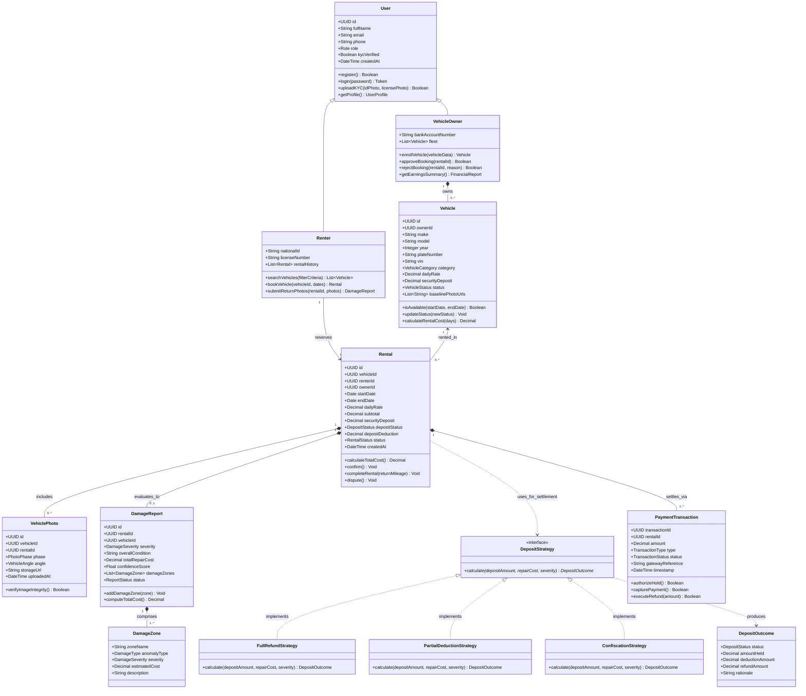
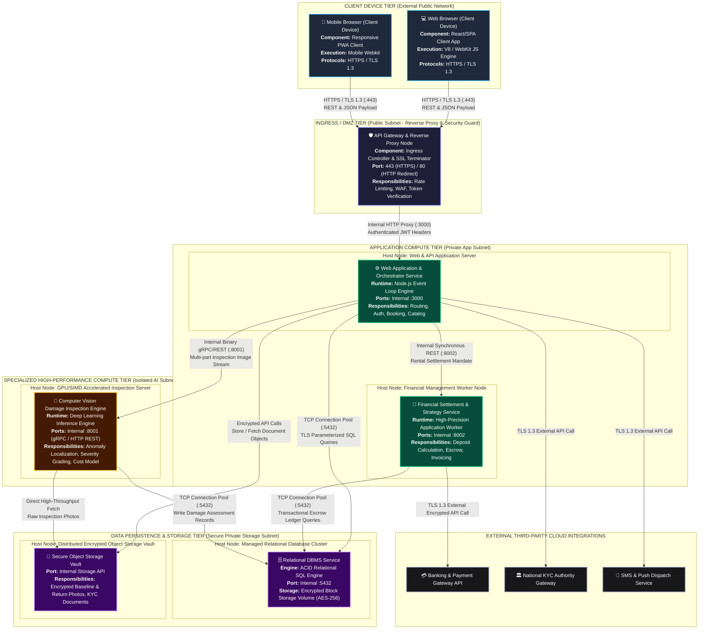
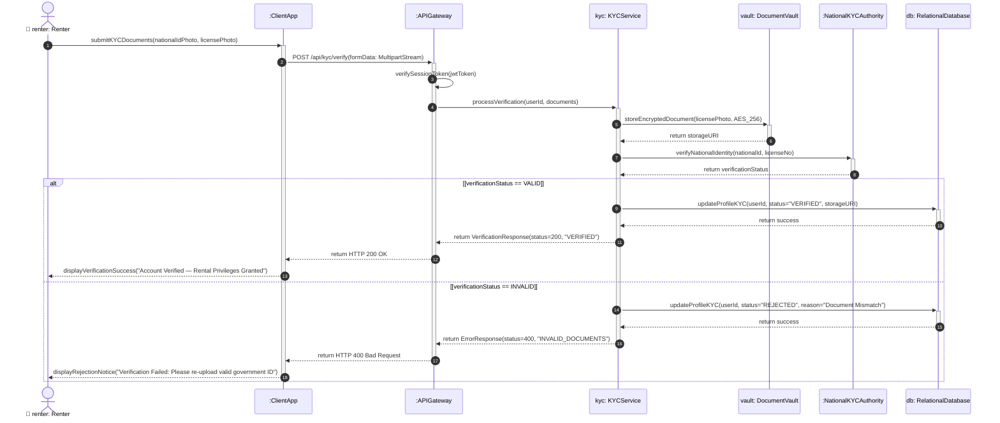
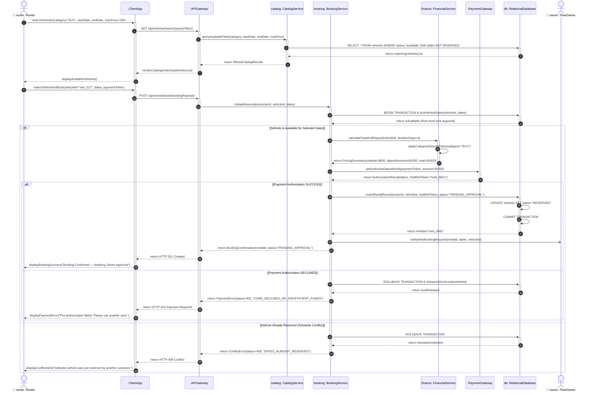
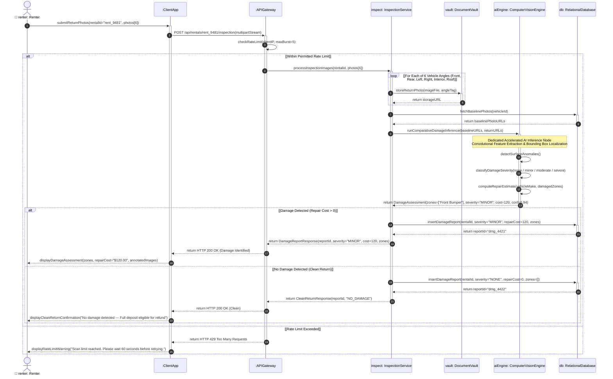
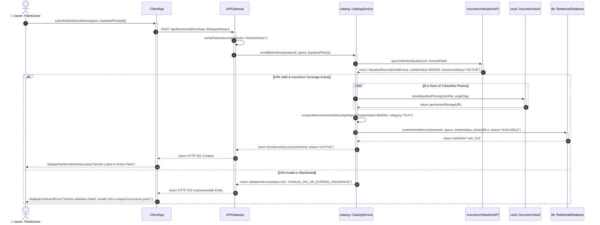
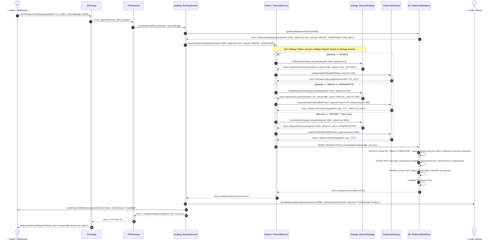

# Phase 2: Software Architecture Design Document (ADD)
## Smart Car Rental Platform
**Academic Course:** Software Engineering for Cloud Applications / Software Architecture  
**Institution:** Arab Academy for Science, Technology and Maritime Transport (AASTMT)  
**Deliverable:** Phase 2 Complete Architecture Design Document & Diagrammatic Specifications  
**Methodology:** Attribute-Driven Design (ADD v3.0)

---

## Executive Summary & ADD Methodology Overview

This document presents the complete architectural design for the **Smart Car Rental Platform**, engineered using the **Attribute-Driven Design (ADD)** methodology developed by the Software Engineering Institute (SEI). 

The ADD process recursively decomposes the system by choosing architectural patterns and tactics that satisfy the prioritized **Architecturally Significant Requirements (ASRs)** and **Quality Attribute Scenarios** established in Phase 1:

```
[Phase 1 Inputs: ASRs & Utility Tree Scenarios]
                     │
                     ▼
       ┌───────────────────────────┐
       │ Step 1: Choose System     │
       │ Element to Decompose      │
       └─────────────┬─────────────┘
                     ▼
       ┌───────────────────────────┐
       │ Step 2: Formulate ASRs    │
       │ for Selected Element      │
       └─────────────┬─────────────┘
                     ▼
       ┌───────────────────────────┐
       │ Step 3: Select Suitable   │
       │ Architectural Patterns    │ ───► Layered + Microservices + Strategy
       └─────────────┬─────────────┘
                     ▼
       ┌───────────────────────────┐
       │ Step 4: Instantiate &     │
       │ Allocate Responsibilities │ ───► System Context, Uses, Class Diagrams
       └─────────────┬─────────────┘
                     ▼
       ┌───────────────────────────┐
       │ Step 5: Define Runtime &  │
       │ Deployment Structures     │ ───► Unified C&C + Allocation Diagram
       └─────────────┬─────────────┘
                     ▼
       ┌───────────────────────────┐
       │ Step 6: Validate with     │
       │ Sequence Interaction Flow │ ───► 5 Core Dynamic Sequence Diagrams
       └─────────────┬─────────────┘
                     ▼
       ┌───────────────────────────┐
       │ Step 7: Assess Quality    │
       │ Attributes & Tactics      │ ───► Traceability & Rationale Matrix
       └───────────────────────────┘
```

---

# 1. System Context Diagram (View 1)

### 1.1 Diagram Description
The System Context Diagram defines the formal boundary of the Smart Car Rental Platform (DFD Level 0 equivalent). It identifies all external human actors and peripheral third-party software systems that interact directly with the platform, showing all primary directed data flows across the system boundary.

### 1.2 System Context Diagram (Mermaid)

```mermaid
flowchart TB
    subgraph Primary_Actors ["Human Actors"]
        Renter["👤 Renter / Customer<br/>(Browses, Reserves, Scans)"]
        Owner["👤 Vehicle Owner<br/>(Enrolls Fleet, Approves)"]
        Admin["👤 System Administrator<br/>(Audits, Overrides, Governs)"]
    end

    subgraph System_Boundary ["System Boundary: Smart Car Rental Platform"]
        CoreSystem(("🚗 Smart Car Rental<br/>Platform Core System"))
    end

    subgraph External_Services ["External Peripheral Services"]
        GovKYC["🏛️ National Identity &<br/>Driving License Authority"]
        PaymentGW["💳 External Payment &<br/>Escrow Gateway"]
        SMSNotify["📱 SMS & Push Notification<br/>Gateway"]
        MapService["🗺️ Geospatial & Navigation<br/>Service API"]
        InsuranceAPI["🛡️ Insurance & Valuation<br/>Service API"]
    end

    %% Actor Interactions
    Renter -->|"1. Registration, Search Filters, Booking, Photos"| CoreSystem
    CoreSystem -->|"2. Catalog, Reservation Confirmation, Damage Report"| Renter

    Owner -->|"3. Vehicle Enrollment, Terms, Approval Decisions"| CoreSystem
    CoreSystem -->|"4. Booking Requests, Fleet Payouts, Inspection Summaries"| Owner

    Admin -->|"5. Audit Queries, KYC Approval Overrides, System Config"| CoreSystem
    CoreSystem -->|"6. Operational Metrics, Audit Logs, Incident Alerts"| Admin

    %% External System Interactions
    CoreSystem -->|"7. Identity & License Verification Request"| GovKYC
    GovKYC -->|"8. Verification Validity Status & Metadata"| CoreSystem

    CoreSystem -->|"9. Payment Capture & Deposit Authorization"| PaymentGW
    PaymentGW -->|"10. Authorization Token, Settlement Confirmation"| CoreSystem

    CoreSystem -->|"11. Dispatch Alert / Transactional SMS Message"| SMSNotify
    SMSNotify -->|"12. Delivery Confirmation Receipt"| CoreSystem

    CoreSystem -->|"13. Coordinates, Route Query, Mileage Query"| MapService
    MapService -->|"14. Distance Matrix, Route Geometries, Maps"| CoreSystem

    CoreSystem -->|"15. Vehicle Plate, VIN, Model Inquiry"| InsuranceAPI
    InsuranceAPI -->|"16. Baseline Valuation & Policy Coverage Status"| CoreSystem

    classDef actor fill:#1e293b,stroke:#3b82f6,stroke-width:2px,color:#f8fafc;
    classDef system fill:#0f172a,stroke:#f59e0b,stroke-width:3px,color:#ffffff;
    classDef external fill:#1e293b,stroke:#10b981,stroke-width:2px,color:#f8fafc;

    class Renter,Owner,Admin actor;
    class CoreSystem system;
    class GovKYC,PaymentGW,SMSNotify,MapService,InsuranceAPI external;
```



### 1.3 Boundary Data Flow Specification

| External Entity | Input Data Flow (To System) | Output Data Flow (From System) | Architectural Purpose |
|---|---|---|---|
| **Renter** | Account credentials, KYC photos, reservation dates, vehicle filters, return damage photos. | Vehicle listings, booking vouchers, damage assessment cost breakdown, deposit refund receipts. | Primary consumer of rental services. |
| **Vehicle Owner** | Vehicle specifications (VIN, plate, model), daily rate, deposit requirement, approval actions. | Booking requests, fleet utilization analytics, damage compensation payouts. | Fleet asset provider and approver. |
| **System Administrator** | Governance policies, manual verification overrides, fee calibration rules. | Audit logs, security alerts, aggregate financial settlement reports. | Operational governance and compliance. |
| **Identity / KYC Authority** | Verified identity confirmation, document authenticity validation. | Encrypted applicant national ID number and driving license payload. | Regulatory compliance and fraud mitigation. |
| **Payment Gateway** | Payment authorization tokens, settlement webhooks, refund transaction receipts. | Cardholder authorization request, payment capture amount, deposit hold mandate. | Secure cashless financial settlement. |
| **SMS / Notification Gateway**| SMS dispatch delivery receipts, bounce notifications. | Outgoing transactional alerts, OTP codes, booking confirmation messages. | Renter / owner real-time notifications. |
| **Geospatial & Mapping API** | Route distance, travel time estimates, reverse geocoded locations. | Pickup/dropoff coordinates, route waypoint queries. | Location filtering & roadtrip fuel calculation. |

---

# 2. Module Structure Diagrams (View 2)

The Module Structure View defines how the software source code is logically decomposed into decoupled, maintainable code units and layers. In accordance with course guidelines, this view contains two distinct diagrams:
1. **The Uses Diagram** (Dependencies between functional layers and modules)
2. **The Class Diagram** (Detailed object structure, properties, methods, and relationships)

---

## 2.1 The Uses Diagram (Module Dependency View)

### Description
The Uses Diagram illustrates the hierarchical layering of modules. A directed arrow from **Module A to Module B** denotes that **A requires the presence and correct functioning of B to fulfill its responsibility** (`A uses B`). Strict unidirectional layering guarantees acyclic dependencies and high maintainability.

```mermaid
flowchart TD
    subgraph Presentation_Layer ["Layer 1: Presentation & Client Modules"]
        M_UI["🖥️ Web & Mobile Client Interface Module"]
        M_State["🔄 Client State & Form Validation Module"]
    end

    subgraph Ingress_Layer ["Layer 2: API & Gateway Control Modules"]
        M_Router["🚦 API Ingress & Routing Controller Module"]
        M_AuthMiddleware["🛡️ Authentication & Authorization Guard Module"]
        M_InputSanitizer["🧹 Input Validation & Schema Sanitizer Module"]
    end

    subgraph Service_Layer ["Layer 3: Application Service Modules"]
        M_UserService["👤 User & KYC Verification Service Module"]
        M_CatalogService["🚗 Vehicle Catalog & Search Service Module"]
        M_BookingService["📅 Reservation & Contract Management Service Module"]
        M_DamageService["🔍 Inspection & AI Damage Analysis Service Module"]
        M_FinanceService["💰 Financial Settlement & Deposit Strategy Service Module"]
        M_NotifyService["🔔 Notification & Dispatcher Service Module"]
    end

    subgraph Domain_Layer ["Layer 4: Domain Core & Business Rules"]
        M_DomainModel["📦 Core Entities (User, Vehicle, Rental, DamageReport)"]
        M_DepositStrategy["⚖️ Deposit Strategy Pattern Module (Full, Partial, Confiscate)"]
        M_DamageScorer["📐 Damage Zone & Cost Calculation Logic"]
    end

    subgraph Data_Access_Layer ["Layer 5: Data Access & Integration Modules"]
        M_Repo["🗄️ Persistence Repositories (CRUD & Transactions)"]
        M_ObjectVault["📁 Document & Photo Storage Adapter"]
        M_PaymentAdapter["💳 External Payment Gateway Client Adapter"]
        M_SMSAdapter["📱 External Notification Client Adapter"]
    end

    %% Dependencies (Uses)
    M_UI --> M_State
    M_State --> M_Router
    
    M_Router --> M_AuthMiddleware
    M_Router --> M_InputSanitizer
    M_Router --> M_UserService
    M_Router --> M_CatalogService
    M_Router --> M_BookingService
    M_Router --> M_DamageService
    M_Router --> M_FinanceService

    M_UserService --> M_DomainModel
    M_UserService --> M_Repo
    M_UserService --> M_ObjectVault

    M_CatalogService --> M_DomainModel
    M_CatalogService --> M_Repo

    M_BookingService --> M_DomainModel
    M_BookingService --> M_Repo
    M_BookingService --> M_FinanceService
    M_BookingService --> M_NotifyService

    M_DamageService --> M_DomainModel
    M_DamageService --> M_DamageScorer
    M_DamageService --> M_ObjectVault
    M_DamageService --> M_Repo

    M_FinanceService --> M_DomainModel
    M_FinanceService --> M_DepositStrategy
    M_FinanceService --> M_PaymentAdapter
    M_FinanceService --> M_Repo

    M_NotifyService --> M_SMSAdapter

    M_Repo --> M_DomainModel
    M_DepositStrategy --> M_DomainModel
    M_DamageScorer --> M_DomainModel

    classDef pres fill:#1e3a8a,stroke:#60a5fa,stroke-width:2px,color:#ffffff;
    classDef ingr fill:#312e81,stroke:#818cf8,stroke-width:2px,color:#ffffff;
    classDef serv fill:#064e3b,stroke:#34d399,stroke-width:2px,color:#ffffff;
    classDef dom fill:#78350f,stroke:#fbbf24,stroke-width:2px,color:#ffffff;
    classDef data fill:#4c1d95,stroke:#c084fc,stroke-width:2px,color:#ffffff;

    class M_UI,M_State pres;
    class M_Router,M_AuthMiddleware,M_InputSanitizer ingr;
    class M_UserService,M_CatalogService,M_BookingService,M_DamageService,M_FinanceService,M_NotifyService serv;
    class M_DomainModel,M_DepositStrategy,M_DamageScorer dom;
    class M_Repo,M_ObjectVault,M_PaymentAdapter,M_SMSAdapter data;
```



---

## 2.2 Detailed Class Diagram (Domain & Object View)

### Description
The Class Diagram models the core structural entities, their internal fields, member methods, access visibility (`+` public, `-` private, `#` protected), and precise object-oriented relationships. It demonstrates the **Strategy Pattern** applied to the security deposit computation.



---

# 3 & 4. Unified Component & Connector (C&C) and Allocation (Deployment) Structure Diagram

### 3.1 Unification Rationale (Physical Section, Week 9)
Per the course architectural guidelines, the **Component & Connector (C&C)** view and the **Allocation (Deployment)** view are unified into a single holistic diagram. 
- **C&C semantics:** Models concurrent executing components, data buses, thread pools, and protocols.
- **Allocation semantics:** Maps those runtime components onto physical and virtualized computing hardware, execution environments, network zones, subnets, and communication links.

### 3.2 Combined C&C + Deployment Architecture Diagram



### 3.3 Hardware & Allocation Mapping Table

| Logical Runtime Component | Hosting Node / Environment | Network Zone | Protocols & Ports | Allocation Justification |
|---|---|---|---|---|
| **Web & Mobile Client Application** | End-User Client Devices (PC, Mobile, Tablets) | Public Internet | Outgoing HTTPS (Port 443) | Executed client-side; zero operational server rendering cost for static UI assets. |
| **Ingress API Gateway & WAF** | Dedicated Reverse Proxy Node | DMZ / Public Subnet (`10.0.1.0/24`) | Inbound 443, Outbound to App Subnet | Shields application servers from DDoS attacks; centralizes TLS termination and SSL certificate renewals. |
| **Web Application & Orchestrator** | Virtualized Application Server Node | Private Application Subnet (`10.0.10.0/24`) | Internal Port 3000 | Isolated from public internet; handles core orchestration, session management, and business routing. |
| **Computer Vision Damage Engine** | Accelerated Compute Node (SIMD/GPU) | Isolated AI Subnet (`10.0.11.0/24`) | Internal Port 8001 (gRPC/REST) | High-throughput image tensor manipulation requires dedicated CPU/GPU allocation without impacting general API responsiveness. |
| **Financial Strategy Service** | Application Worker Node | Private Application Subnet (`10.0.10.0/24`) | Internal Port 8002 (HTTP REST) | Decoupled financial settlement engine ensuring strict auditability and adherence to Strategy pattern. |
| **Relational Database Cluster** | High-Memory Database Node (Multi-AZ) | Private Data Subnet (`10.0.20.0/24`) | Internal Port 5432 (PostgreSQL TCP) | Only accepts inbound traffic from security groups of Application and AI nodes; encrypted persistent SSD storage. |
| **Secure Object Storage Vault** | Distributed Cloud Object Store | Managed Cloud Storage Tier | Encrypted HTTPS / IAM API | Dedicated, highly available multi-region durability for high-resolution vehicle photos and KYC documents. |

---

# 5. Sequence Diagrams (Dynamic Behavioral View)

The Dynamic Behavioral View models the runtime interaction between system components over time. In accordance with formal UML 2.5 Sequence Diagram standards and the course Software Requirements Specification (SRS) guidelines, each sequence diagram adheres to the following structural conventions:

| UML Element | Diagram Representation | Semantic Meaning in Architecture |
|---|---|---|
| **Actor (Stick Figure)** | `actor name as 👤 instance: Role` | External human or external entity initiating/participating in interactions outside the system boundary. |
| **Object / Component** | `participant name as instance: ClassName` | Internal system software component or executing service instance. |
| **Lifeline** | Vertical dashed line extending downwards | Represents the existence of the participating object over time along the vertical axis. |
| **Activation Bar** | Solid narrow rectangle on lifeline (`+` / `-`) | Denotes the active execution period during which the component is executing an internal method or waiting on delegated subroutines. |
| **Synchronous Message** | Solid line with filled arrowhead (`->>`) | Blocking remote call or procedure invocation; caller halts and waits until execution completes. |
| **Asynchronous Message** | Solid line with open arrowhead (`-)`) | Non-blocking message or event dispatch (e.g. push notification, email dispatch). |
| **Reply / Return Message** | Dashed line with open arrowhead (`-->>`) | Explicit return of control, data payload, or status token from the callee back to the caller. |
| **Self-Call (Internal Action)** | Reflexive loop back to the same lifeline | Internal component computation (e.g., token verification, cost calculation, anomaly detection). |
| **Alternative Fragment (`alt`/`else`)** | Guarded condition box with dashed divider | Mutually exclusive execution paths based on evaluated boolean guard conditions (e.g., `[Valid]`, `[Invalid]`). |
| **Loop Fragment (`loop`)** | Iteration boundary box | Repeated execution sequence (e.g., processing multi-angle photos). |

---

## 5.1 Flow 1: Customer Identity Verification & KYC



**Scenarios satisfied:**
- **S-1 (Confidentiality & Encryption):** Documents stored in Vault with AES-256 server-side encryption; zero plaintext leakage.
- **S-2 (Input & Perimeter Defense):** API Gateway validates JWT session token and rejects malformed multipart payloads prior to service forwarding.

---

## 5.2 Flow 2: Vehicle Search, Filter & Reservation Booking



**Scenarios satisfied:**
- **P-1 (Search Latency ≤1.5s):** Fast indexed catalog retrieval at Layer 3.
- **ASR-06 (ACID Consistency):** Database row locking (`SELECT FOR UPDATE`) prevents double-booking race conditions; explicit rollback on payment decline.

---

## 5.3 Flow 3: AI Vehicle Damage Inspection & Assessment



**Scenarios satisfied:**
- **P-2 (Inspection Latency ≤15s):** Dedicated GPU/SIMD inference node processes 6-angle image stream and delivers localized bounding boxes within latency budget.
- **S-1 (Confidentiality):** High-resolution inspection photos encrypted at rest in Object Vault.

---

## 5.4 Flow 4: Vehicle Owner Fleet Enrollment



**Scenarios satisfied:**
- **FR-07 (Listing Creation):** Enrolls vehicle specifications and calculates baseline deposit tier.
- **FR-08 (Baseline Photo Ingestion):** Stores permanent reference images in Object Vault for future AI differential comparison.

---

## 5.5 Flow 5: Rental Return, Deposit Calculation & Financial Settlement



**Scenarios satisfied:**
- **M-1 (Modifiability via Strategy Pattern):** Financial deposit settlement calculation dynamically delegated to pluggable `DepositStrategy` implementations without modifying reservation lifecycle orchestration.
- **ASR-06 (Data Integrity & Consistency):** Multi-table financial and inventory state updates enclosed in atomic ACID database transaction.

---

# 6. Architectural Patterns, Tactics, and Rationales (ADD Traceability Matrix)

### 6.1 Architectural Patterns Applied

1. **Layered Architecture Pattern (N-Tier):**
   - *Rationale:* Decouples presentation from business logic and physical storage. Ensures that changes to database schemas or third-party gateways do not ripple into user interface components.
2. **Modular Service-Oriented Decomposition:**
   - *Rationale:* Isolates computationally intensive workloads (such as Deep Learning Computer Vision inference) from transactional web handling. Guarantees that slow image processing cannot cause thread starvation for user browsing and booking.
3. **Strategy Pattern (GoF Behavioral Pattern):**
   - *Rationale:* Implemented across `DepositStrategy`, `FullRefundStrategy`, `PartialDeductionStrategy`, and `ConfiscationStrategy`. Allows business rules governing deposit deductions to evolve or vary by car tier without requiring changes to the core checkout pipeline.
4. **API Gateway & Reverse Proxy Pattern:**
   - *Rationale:* Serves as the single ingress boundary for all client devices. Consolidates SSL/TLS termination, rate-limiting, and centralized JWT authorization validation, shielding downstream internal application services.

---

### 6.2 Architectural Tactics Mapped to Prioritized Quality Attributes

| Quality Attribute | Phase 1 ASR / Scenario | Architectural Tactic Applied | Concrete Mechanism in Design | Observable Architectural Result |
|---|---|---|---|---|
| **Availability** | Scenario A-1 (Worker Failover) | **Fault Detection & Supervisor Restart** | Health check endpoints monitored by process orchestrator; stateless application nodes. | If a worker process fails, orchestrator replaces it within **2 seconds** without data corruption. |
| **Availability** | Scenario A-2 (DB Connection Failover) | **Retry with Exponential Backoff & Connection Pooling** | Data Access Repository encapsulates exponential backoff connection pool manager. | Transient network blips absorb delays without terminating active transactions. |
| **Performance** | Scenario P-1 (Catalog Search Latency) | **Resource Caching & Query Indexing** | In-memory cache layer for vehicle fleet status; indexed multi-column database keys (`category`, `daily_rate`, `status`). | 95% of catalog search requests resolve in **< 1.5 seconds** under 1,000 concurrent queries. |
| **Performance** | Scenario P-2 (Damage Analysis Latency) | **Dedicated Compute Tier & Asynchronous Processing** | Dedicated high-performance Computer Vision node with accelerated tensor inference. | Full 6-image damage inspection finishes in **< 15 seconds**. |
| **Security** | Scenario S-1 (Identity Document Protection) | **Encrypt at Rest & Encrypt in Transit** | TLS 1.3 for all ingress links; AES-256 server-side encryption for national IDs and licenses in object vault. | Zero plaintext exposure of sensitive customer documents. |
| **Security** | Scenario S-2 (Injection & Tampering Defense) | **Validate Input at Perimeter & Parameterize Queries** | API Gateway input schema validation; parameterized SQL query abstraction in Data Access Layer. | 100% of SQL injection and XSS payloads rejected at ingress. |
| **Modifiability** | Scenario M-1 (New Deposit Rules) | **Encapsulate Variation & Strategy Pattern** | Abstract `DepositStrategy` interface decouples computation logic from `Rental` orchestration. | New deposit rules introduced in **<= 2 person-days** with 0 regressions. |
| **Scalability** | Scenario SC-1 (Holiday Traffic Surge) | **Stateless Processing & Horizontal Elastic Scaling** | Stateless API workers; session state externalized via cryptographically signed tokens. | System handles 400% traffic spikes with < 20% latency variation. |

---

# 7. Board Presentation & Oral Defense Guide

When presenting this architecture on the board during your personal discussion, follow this 4-step sequence to guarantee full marks:

### Step 1: Open with the System Context (1 minute)
- Point to the central **Smart Car Rental Core System** circle.
- Explain the 3 human actors: **Renter**, **Vehicle Owner**, **Administrator**.
- Point to the 5 external systems: **Identity Authority (KYC)**, **Payment Gateway**, **SMS Provider**, **Map Service**, **Insurance API**.
- Highlight that the system boundary cleanly encapsulates all business logic while treating external APIs as peripheral services.

### Step 2: Explain the Structural Decomposition (2 minutes)
- Point to the **Uses Diagram** and explain the 5 layers: Presentation, API Control, Application Services, Domain Logic, and Data Access. Emphasize that all arrows flow **strictly downwards** (acyclic dependencies).
- Point to the **Class Diagram** and highlight the **Strategy Pattern** for `DepositStrategy` (`FullRefund`, `PartialDeduction`, `Confiscation`). Explain that this directly fulfills **Modifiability (Scenario M-1)**.

### Step 3: Walk Through the Unified C&C and Deployment Diagram (3 minutes)
- Explain why C&C and Deployment are combined: **"Per Week 9 guidelines, this maps our runtime software components directly onto their physical and virtual hardware nodes."**
- Walk through the 5 Tiers:
  1. *Client Tier:* Web and mobile browsers connecting over TLS 1.3 (:443).
  2. *Ingress / DMZ Tier:* API Gateway terminating SSL, enforcing rate limits, and protecting internal nodes.
  3. *Application Compute Tier:* Stateless Web/API and Financial Settlement nodes.
  4. *Specialized AI Compute Tier:* Dedicated inspection engine node with GPU/tensor acceleration to fulfill **Performance (Scenario P-2)**.
  5. *Persistence Tier:* Relational Database Cluster (PostgreSQL) and Encrypted Object Storage.

### Step 4: Trace a Sequence Diagram to Prove a Quality Attribute (2 minutes)
- Pick **Flow 3 (AI Damage Inspection)** or **Flow 5 (Rental Return & Settlement)**.
- Trace the exact message numbers from the Renter's photo upload down through the AI inspection engine, the database record, and the payment gateway refund.
- Conclude: **"Every design decision in Phase 2 directly originates from our Phase 1 Quality Attribute Scenarios and ASRs."**
